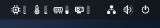
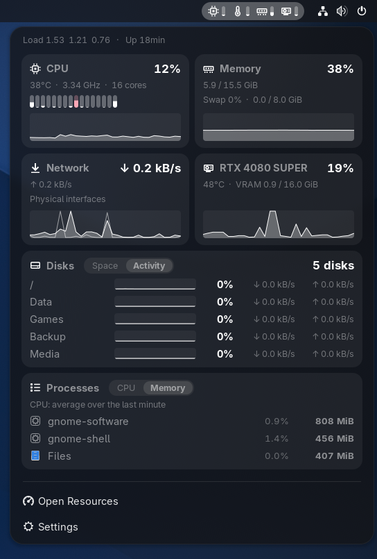

# Resource Bar

A system resource monitor for the GNOME Shell top bar, inspired by the **sysmon** widget of
[Noctalia Shell](https://github.com/noctalia-dev/noctalia-shell). Each metric is a compact item, an
**icon + a pill gauge (or a history graph)**, optionally followed by its value, that tints toward an alert
color as the value crosses its *activity* and *critical* thresholds.





For GNOME Shell 51 (Wayland and X11 sessions alike). The interface follows the system language; see
[Translations](#translations).

## What it shows

| ID | Metric | Source |
|---|---|---|
| `cpu_usage` | CPU usage (optionally one bar per core) | `/proc/stat` |
| `cpu_temp` | CPU temperature | hwmon `k10temp`/`zenpower` (Tctl/Tdie), `coretemp`, thermal zones |
| `cpu_freq` | Average CPU frequency | `/proc/cpuinfo` |
| `gpu_usage`, `gpu_temp`, `gpu_vram`, `gpu_vram_used` | GPU | NVIDIA via `nvidia-smi`, AMD via sysfs |
| `ram_pct`, `ram_used` | Memory | `/proc/meminfo` (`MemTotal − MemAvailable`) |
| `swap_pct` | Swap | `/proc/meminfo` |
| `disk_used_pct`, `disk_used`, `disk_free_pct`, `disk_free`, `disk_util` | Disk space and activity, for the default disk or a specific one (`disk_used_pct:/mnt/data`) | `/proc/self/mounts`, `statfs`, `/proc/diskstats` |
| `net_rx`, `net_tx` | Download / upload | `/proc/net/dev` (physical interfaces by default) |

Clicking the item opens a menu with cards for CPU (with per-core bars), memory and swap, network
(download and upload on one graph) and GPU, every mounted disk, the processes using the most CPU or memory,
and the load average and uptime.

### Top processes

The **Processes** card lists up to five processes (none to five, set in the preferences; three by default),
sorted by memory (default) or CPU with the **CPU | Memory** switch on the card. Processes that belong to an app with a
window show its icon and name. CPU is the share of the whole machine averaged over the last 30 seconds,
1 minute (default) or 5 minutes, so the list stays stable instead of reshuffling every second; memory is
the current resident set. Processes are read every 5 seconds in the background (only while the option is not
“None”), so the average is ready the moment the menu opens, and every update while it is open. All
`/proc/*/stat` files are read by a single short-lived `cat`, which keeps the cost at about 0.5 % of one
CPU core in the background.

### Disks

Disks are found in `/proc/self/mounts`: local filesystems (ext4, btrfs, xfs, ntfs3, exfat, vfat…) are
listed; `/boot`, `/efi`, read-only images (ISO) and pseudo filesystems are left out, and btrfs subvolumes of
the same partition (`/` and `/home`) appear once.

In the preferences, a disk metric can be pinned to any disk, and **All disks** adds a “Disk used (%)” item
for every disk not yet in the top bar. Disk items show the disk name next to the icon, and `--` when the disk
is unmounted.

The **Disks** card has a **Space | Activity** switch (Activity by default). *Space* shows the used space; *Activity* shows, per
disk, a graph of the last 30 seconds of busy time (like `iostat`’s `%util`, read from `/proc/diskstats`
without waking sleeping disks) with read (↓) and write (↑) speeds.

## Install

From [extensions.gnome.org](https://extensions.gnome.org) (once published), or from source:

```bash
git clone https://github.com/Ticko4/gnome-resource-bar.git
cd gnome-resource-bar
./install.sh
```

The script installs the extension in `~/.local/share/gnome-shell/extensions` and enables it. On Wayland,
log out and back in for it to appear. `./install.sh --pack` builds the zip for extensions.gnome.org.
The listing icon there is `docs/icon.png` (512 px, drawn from `docs/icon.svg`); it is not part of the zip and
is uploaded on the extension’s page by clicking the puzzle icon next to its name.

## Preferences

`gnome-extensions prefs resource-bar@ticko4.github.io`, or **Settings** in the extension’s menu:

- **Top Bar**: number of top processes in the menu; which metrics and in what order (CPU usage, CPU temperature, memory and GPU usage by
  default; GPU items hide themselves on machines without a supported GPU); visualization (gauge, graph or
  none); icon, value (off by default), units,
  per-core gauge, minimum value width, spacing, smooth animation, graph colors (default, the system accent
  color, or one color per resource like the Resources app: CPU blue, memory purple, GPU red, disks orange,
  network teal; only graphs change), alert color (default `#FD4663`, Noctalia’s “error”); area and
  position in the top bar.
- **Monitoring**: update interval (1 s by default), pause in fullscreen (on by default), default disk,
  network interface, speed unit and compact format.
- **Thresholds**: activity/critical per metric group, with Noctalia’s defaults (CPU 50/90 %,
  temperature 60/85 °C, memory 60/90 %, swap 20/80 %, disk 80/95 %, disk activity 50/90 %,
  network 1/50 MB/s…).

## How it works

- Every read is asynchronous (`Gio.File.load_contents_async`, `query_filesystem_info_async`, async sensor
  discovery), so the shell never waits on the kernel.
- Pause in fullscreen (on by default): while a fullscreen app or game on the primary monitor hides the top
  bar, nothing is read at all (no timer, no `nvidia-smi`, no process list); when the bar comes back the
  extension reads again at once and graphs start fresh.
- Only what is needed is read: GPU and CPU frequency only while they are in the top bar or the menu is open.
- NVIDIA: a single `nvidia-smi --loop-ms` process runs while the GPU is needed (much cheaper than
  starting it every second) and is stopped afterwards. Runtime-suspended GPUs are not woken up.
- Smooth animation (on by default): gauges glide to each new value and graphs scroll continuously, each
  reading continuing from what is on screen, at up to ~30 fps; changes under a quarter pixel do not animate
  and GNOME’s *Reduce animation* setting turns it off. Value labels only shrink after 10 s so items do not
  shift. Graph mode keeps the top bar redrawing, which costs a little more; it can be turned off.
- Color: below the activity threshold an item uses the top bar text color; past it, it starts at 25 % of the
  alert color and reaches 100 % at the critical threshold (Noctalia’s curve).

## Layout

```
resource-bar@ticko4.github.io/
├── extension.js      indicator, timer, settings
├── prefs.js          preferences window (libadwaita)
├── stylesheet.css
├── lib/sampler.js    reads /proc, /sys, nvidia-smi
├── lib/stats.js      metric catalogue, formatting, thresholds, history
├── lib/widgets.js    gauge, per-core gauges, graph, top bar item
├── lib/popup.js      menu cards
├── lib/mounts.js     disk discovery
├── lib/color.js      color helpers
├── icons/            symbolic icons
└── schemas/          GSettings
po/                   translations (po/update-pot.sh refreshes the template)
```

## Translations

Included: English (source), Arabic, Basque, Bulgarian, Catalan, Chinese (Simplified and Traditional),
Croatian, Czech, Danish, Dutch, Estonian, Finnish, French, Galician, German, Greek, Hebrew, Hindi,
Hungarian, Indonesian, Italian, Japanese, Korean, Latvian, Lithuanian, Norwegian Bokmål, Persian, Polish,
Portuguese (Portugal and Brazil), Romanian, Russian, Serbian, Slovak, Slovenian, Spanish, Swedish, Thai,
Turkish, Ukrainian and Vietnamese.

The translations were drafted with AI assistance and have not all been reviewed by native speakers yet:
corrections are very welcome. See [po/TRANSLATING.md](po/TRANSLATING.md) for context on every string;
`po/update-pot.sh` refreshes the template, and `python3 po/check_po.py po/<lang>.po` checks a file.

## Limitations

- Intel integrated GPUs: no usage or VRAM (not exposed in a simple way by the kernel).
- `nvidia-smi` keeps an NVIDIA GPU awake while it runs; on hybrid-graphics laptops, keep GPU metrics out of the
  top bar if you want it to suspend.

## License

GPL-2.0-or-later. See [LICENSE](LICENSE).

The look and default thresholds follow Noctalia Shell’s sysmon widget
([MIT](https://github.com/noctalia-dev/noctalia-shell)); no Noctalia code was copied.
